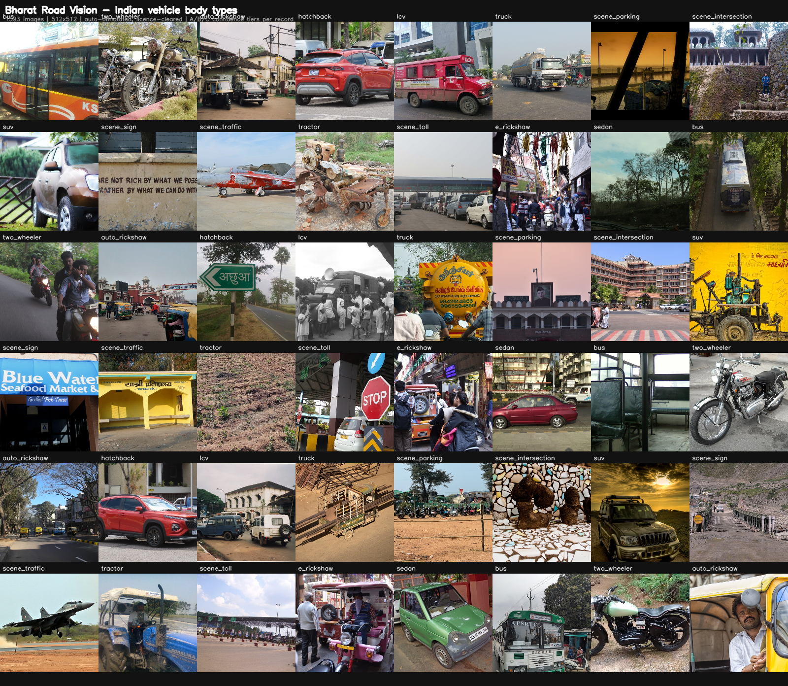

# Bharat Road Vision

**An Indian road-transport image dataset for vehicle body-type recognition on cheap edge hardware.**

Built from scratch for a **~5M-parameter** vision model that has to run on solar-powered roadside cameras, toll-plaza gateways, Raspberry-Pi-class terminals and budget Android phones — no cloud round-trip, no GPU.

Every image was harvested by my own crawler and **labelled by my own annotation pipeline** (`tools/annotate.py`). No third-party annotated dataset was downloaded, copied or re-licensed. Every record carries its upstream licence, author and a human-checkable source page.



---

## What's inside

| | |
|---|---|
| **Records** | 1,593 images @ 512×512 JPEG |
| **Vehicle images** | 1,562 across 10 Indian body-type classes |
| **Scene images** | 31 toll/intersection/parking/signage scenes for use-case training |
| **Class-balanced core** | 555 images with train/val/test splits (equal-cap per class) |
| **Extra tail** | 1,007 additional vehicle images for fine-tuning or long-tail work |
| **Licences** | CC BY / CC BY-SA / CC0 / public domain — per record |
| **Sources** | Wikimedia Commons (1,289) and Openverse-licensed originals (273) |
| **Annotation fields** | bbox, 12 geometric/colour/structure features, confidence, tier, per-class rule scores |

### Classes

| id | label | what it is |
|---|---|---|
| 0 | `two_wheeler` | motorcycle / scooter / moped with rider |
| 1 | `auto_rickshaw` | petrol/CNG three-wheeler, yellow-black or green-yellow |
| 2 | `e_rickshaw` | battery-electric three-wheeler, green or blue canopy |
| 3 | `hatchback` | Swift / WagonR / i10 class small car |
| 4 | `sedan` | Dzire / City / Corolla class, distinct boot |
| 5 | `suv` | Scorpio / Fortuner / Innova / Creta class |
| 6 | `lcv` | Tata Ace / pickup / tempo traveller / van (<3.5 t) |
| 7 | `bus` | city, school, sleeper, minibus, coach |
| 8 | `truck` | lorry, dumper, tanker, multi-axle trailer |
| 9 | `tractor` | agricultural tractor, with or without trolley |

Scene labels: `scene_toll`, `scene_intersection`, `scene_traffic`, `scene_yard`, `scene_parking`, `scene_sign`.

---

## Why the class balance matters for a 5M model

What open sources actually publish is lopsided: buses and trucks dominate, private cars are rare. If you train a small network on the raw counts it collapses into a bus detector. So the repo ships two views:

- **`data/train.jsonl` / `val.jsonl` / `test.jsonl`** — the balanced core (up to 180 images per class), 444 / 71 / 71 records. Train here first.
- **`data/full_annotated.jsonl`** — all 1,593 records, with `class_weight` (inverse-frequency) and `in_balanced_core`. Fine-tune here with weighted sampling.

Filter to it with one line: `[r for r in rows if r["in_balanced_core"]]`.

---

## Use cases this data targets

| Deployment | What the model does | Class the data covers |
|---|---|---|
| Smart toll plaza / parking | classify vehicle → boom barrier, dynamic tariff | all 10 vehicle classes |
| Traffic & signal optimisation | live vehicle-mix count → green-time allocation | all + `scene_intersection` |
| Fleet / logistics yards | log entries of tempos, tractors, heavy trucks | `lcv`, `truck`, `tractor` |
| Rule enforcement | flag two-wheelers on expressways, trucks in city zones at peak | `two_wheeler`, `truck`, `bus` |
| Insurance / used-vehicle verification | on-device body-type check on budget Android | `hatchback`, `sedan`, `suv`, `lcv` |

---

## Files

```
data/
  bharat_road_vision.jsonl   master manifest (all 1,593 records)
  full_annotated.jsonl       identical content, explicit name
  train.jsonl val.jsonl test.jsonl   balanced core, split 80/10/10
  scenes.jsonl               the 31 scene records
  label_map.json             class ids, definitions, field-by-field docs
  stats.json                 counts, tiers, licences, sources
images/
  <label>/<id>.jpg           ready-to-use 512x512 crops
  bharat-part1..3.tar        the same images sharded (<52 MB each)
docs/preview_grid.png        sample screenshot
ATTRIBUTION.md               licence table + how to print per-image credits
tools/                       the whole pipeline: harvest, download, annotate, package
```

### Record format

```json
{
  "id": "9c1f4e0b2a77d3e5",
  "image": "auto_rickshaw/9c1f4e0b2a77d3e5.jpg",
  "label": "auto_rickshaw",
  "label_group": "vehicle",
  "caption": "Which vehicle class is this at an Indian toll plaza? Used for smart toll plaza classification. Answer: auto_rickshaw.",
  "prompt": "…", "target": "auto_rickshaw",
  "use_cases": ["toll_classification", "intersection_counting", "parking_pricing"],
  "confidence": 0.81,
  "confidence_tier": "A",
  "shape_agreement": true,
  "vehicle_evidence": 1.15,
  "rank": {"auto_rickshaw": 2.6, "two_wheeler": 1.1, "hatchback": 0.3},
  "bbox_norm": [0.31, 0.28, 0.78, 0.72],
  "features": {"roi_aspect": 1.18, "edge_density": 0.09, "flatness": 0.41,
               "yellow": 0.21, "green": 0.02, "wheels": 2, "plates": 1, "people": 0,
               "brightness": 0.52, "symmetry": 0.74, "night": false},
  "in_balanced_core": true, "class_weight": 1.0,
  "split": "train",
  "width": 512, "height": 512, "sha256": "…",
  "license": "CC BY-SA 4.0", "attribution": "Author Name",
  "source": "commons", "source_page": "https://commons.wikimedia.org/wiki/File:…",
  "original_url": "https://upload.wikimedia.org/…", "india_evidence": true
}
```

---

## How the labels were made

`tools/annotate.py` is a deterministic hand-written annotator — no neural network, no borrowed annotations:

1. **Relevance gate** — the source title/description/category path must show Indian evidence (city, state, highway) or it is dropped.
2. **Region proposals** — spectral-residual saliency → threshold → connected components give candidate object boxes; a 2×2 grid and centre windows are added.
3. **Feature extraction** per box: aspect ratio, area, edge density, flatness (cargo-box/bus-body test), dark-underside share, symmetry, yellow/green/blue livery shares, wheel circles (Hough), number-plate and person cascades.
4. **Vehicle-evidence gate** — a box must show wheel/plate/underside/cargo structure or the image is rejected.
5. **Classification** — hand-written geometric and colour rules score all 10 classes; the curated discovery query carries the class prior and the geometric score either corroborates it (`shape_agreement: true`) or not.
6. **Confidence tiers** — A ≥ 0.55, B 0.40–0.55, C < 0.40. Tier A is what the balanced core uses.
7. **Crop, hash, dedupe** — square 512 px crop with context, 16×16 dHash with hamming-8 duplicate removal.

Current agreement rate between the curated prior and the geometric rules: **58 %** — honest, and exactly what the `shape_agreement` flag is there to expose.

---

## Training notes for a ~5M parameter model

- **Input**: 128–192 px is enough at this size; 512 px buys little for a 5M net and costs 7× the compute on a solar node.
- **Quantise to INT8** and target < 20 ms/frame on a mid-range ARM core; a MobileNetV3-Small or a 4-block custom CNN both land near 1–3 M params, budget the rest for the classifier head if you need more classes.
- **Use the balanced core first** (444 train images). Add `full_annotated.jsonl` with `class_weight` once the core converges — this recovers the rarer car classes.
- **Augment for the field**: motion blur, low-light gamma, rain streaks, JPEG q40–70, and heavy downscale (budget cameras).
- **Keep a reject class** for non-vehicle motion (cattle, handcarts, people) — Indian roads are full of it and it is not in this label set.

---

## Honest limitations

- **1,593 images is a starting set, not a benchmark.** It is enough to train and validate a 5M-parameter classifier and to build a demo, not enough for state-of-the-art accuracy.
- **Class imbalance remains severe** for rare classes — `sedan` (3), `e_rickshaw` (3), `tractor` (5), `suv` (6), `truck` (9), `lcv` (12), `hatchback` (21). Cars were the hardest thing to find under open licences; buses/trucks are abundant. Train those classes separately or collect more before deployment.
- **Labels are auto-annotated**, verified by geometry rather than by a human eye. Use `confidence_tier` and `shape_agreement` to filter, and spot-check before production.
- **No night/rain balance** — low-light images are a small minority.
- **Single 512 crop per original**, not a detection benchmark. `bbox_norm` is stored if you want to rebuild detection annotations (`tools/export_yolo.py` helps).
- **Licences vary** — CC BY and CC BY-SA require attribution when you redistribute or ship a model trained on this. See `ATTRIBUTION.md`.

---

## Regenerate / extend it

```bash
python3 tools/harvest_openverse.py     # discover CC images by Indian vehicle query
python3 tools/normalize.py             # merge + derive class hints
python3 tools/download.py              # fetch originals (resumable)
python3 tools/annotate.py --montage    # annotate + crop + QC montage
python3 tools/package.py               # splits, manifests, shards, preview grid
```

`tools/harvest_cats.py` crawls Wikimedia Commons categories directly; `tools/export_yolo.py` converts the set to YOLO detection format.

## Citation

```
Bharat Road Vision (2026). Indian vehicle body-type dataset for edge traffic analytics.
https://github.com/Comet-Suite/bharat-road-vision
```
